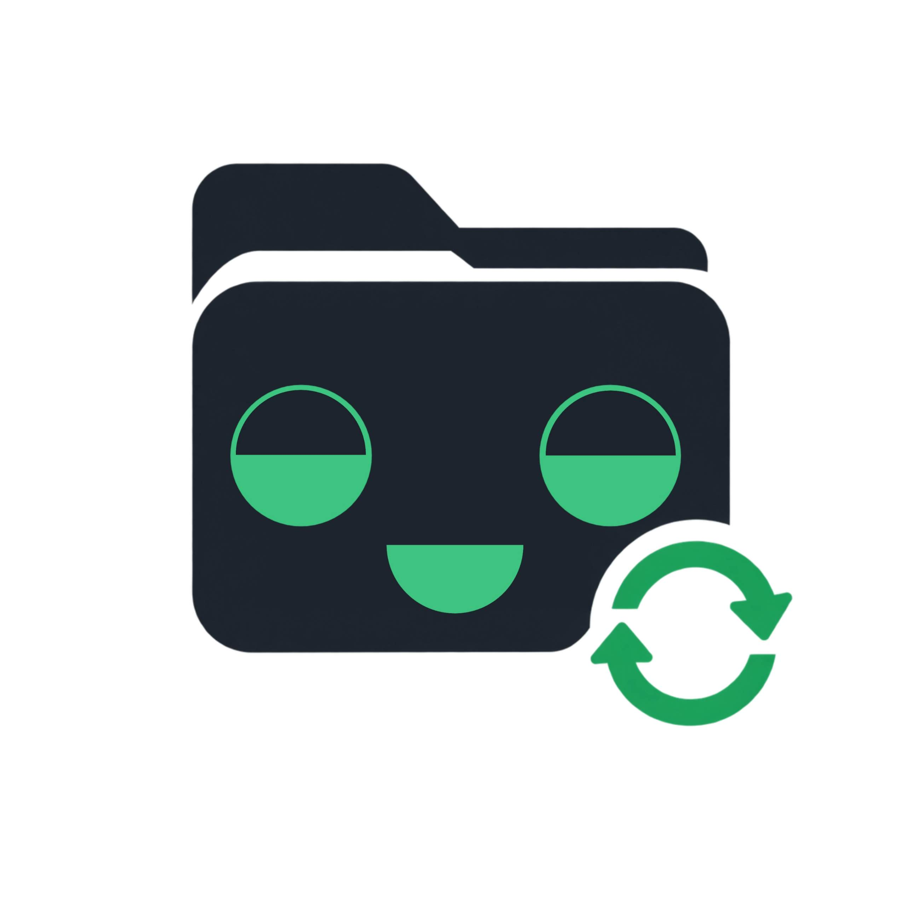
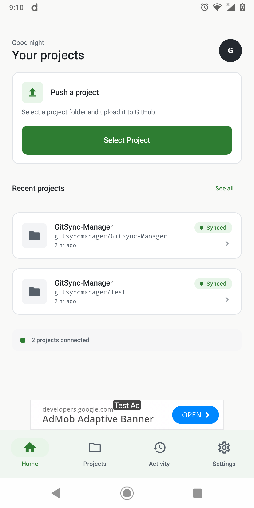
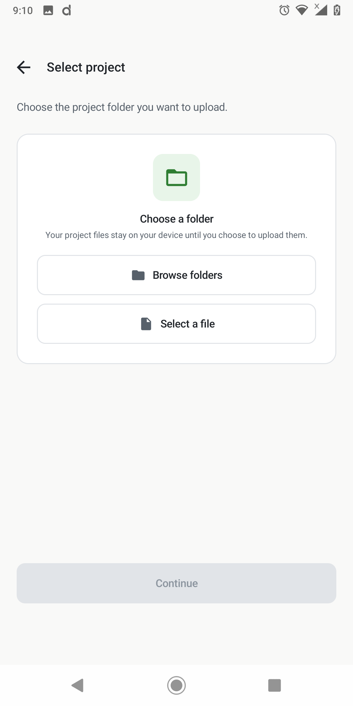
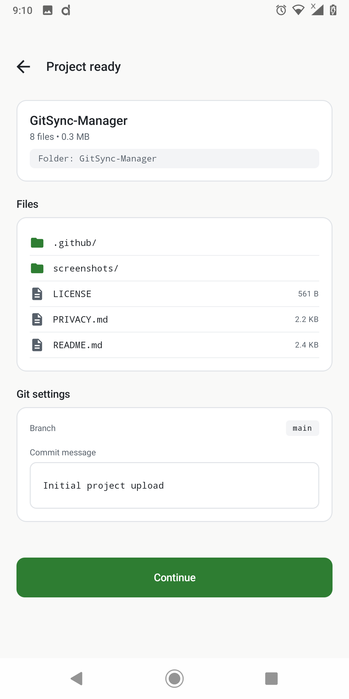
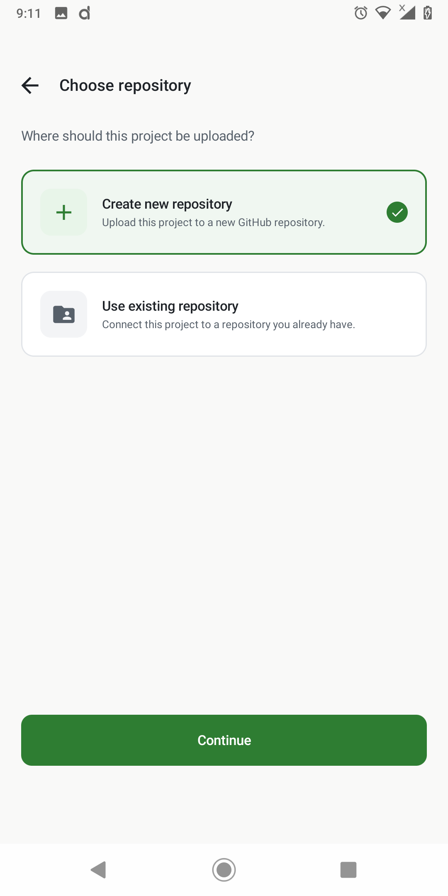
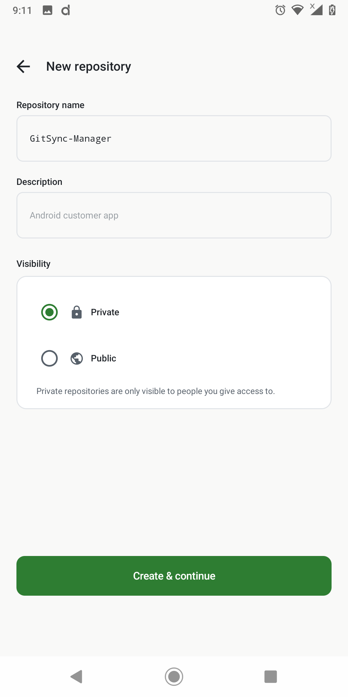
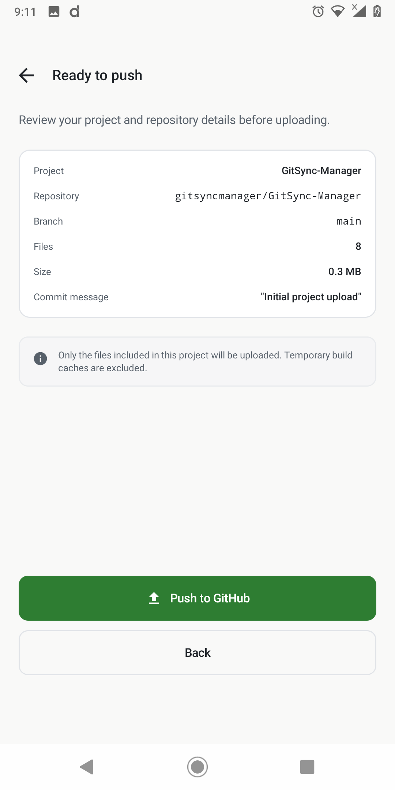
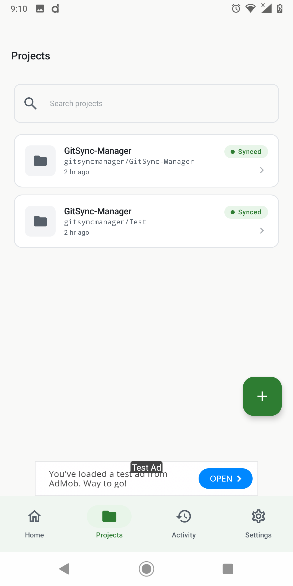
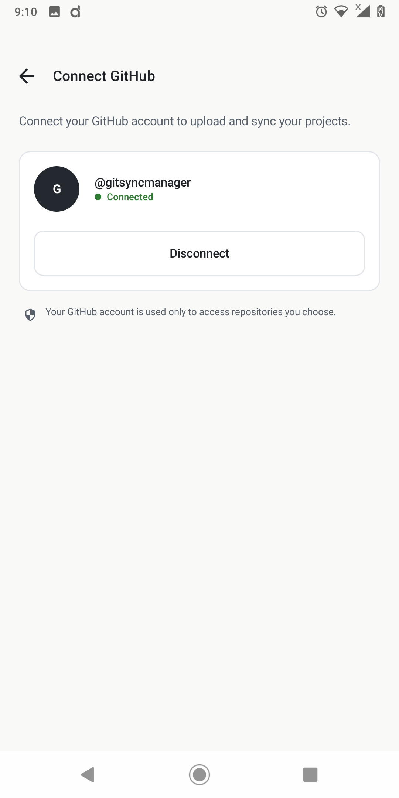
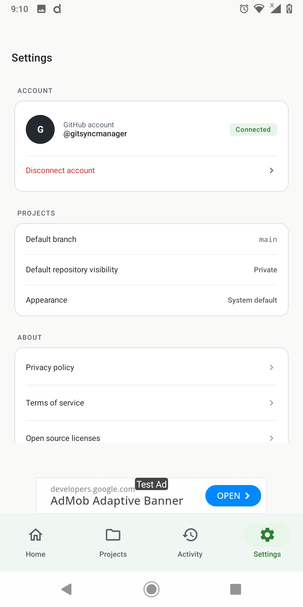

  

<h1 align="center">GitSync Manager</h1>

  <strong>Manage your GitHub projects directly from your phone.</strong>

  Create repositories, upload files and folders, and manage your GitHub projects 
  directly from your Android device.

  

  
  

---

## Screenshots

<table align="center">
  <tr>
    <td align="center"> <b>Home</b></td>
    <td align="center"> <b>Select a project</b></td>
    <td align="center"> <b>Review files and commit</b></td>
  </tr>
  <tr>
    <td align="center"> <b>Choose a repository</b></td>
    <td align="center"> <b>Create a repository</b></td>
    <td align="center"> <b>Ready to push</b></td>
  </tr>
  <tr>
    <td align="center"> <b>Projects</b></td>
    <td align="center"> <b>Connect GitHub</b></td>
    <td align="center"> <b>Settings</b></td>
  </tr>
</table>

---

## About

Plenty of people write and organise code on their phones, but putting that work on GitHub usually means finding a laptop. GitSync Manager removes that step. You pick a project folder or file on your Android device, choose where it should go on GitHub, and push it from the same app.

It is built for developers, students, and hobbyists who work from a phone and want a simple, focused way to get their projects onto GitHub.

## Features

| | Feature | What it does |
|---|---|---|
| **1** | **Create repositories** | Create a new GitHub repository from your phone, with a name, a description, and a Private or Public setting. |
| **2** | **Use existing repositories** | Connect a project to a repository you already have. |
| **3** | **Upload folders** | Browse to a project folder on your device and upload it. |
| **4** | **Upload single files** | Select an individual file to upload. |
| **5** | **Review before you push** | Check the file list, branch, and commit message, then review a summary of project, repository, branch, file count, and size before pushing. |
| **6** | **Project list** | See your connected projects, search them, and check their sync status. |
| **7** | **Settings** | Set a default branch and default repository visibility, and choose the app appearance. |
| **8** | **GitHub sign-in** | Connect your GitHub account using the OAuth Device Flow, and disconnect at any time. |

<!-- REVIEW: Your brief listed "Create and edit README.md files" as a feature. I could not verify it from the screenshots, so it is not listed. Add a row here if the app really has it. -->

## Getting Started

1. Get the APK from the [official release page](https://github.com/gitsyncmanager/GitSync-Manager/releases/latest) 
2. Open GitSync Manager and connect your GitHub account.
3. On the Home screen, tap **Select Project**.
4. Choose a project folder with **Browse folders**, or pick a single file with **Select a file**.
5. Review the project's files, branch, and commit message.
6. Choose **Create new repository** or **Use existing repository**. For a new repository, enter a name, a description, and a visibility.
7. Check the summary on the **Ready to push** screen, then tap **Push to GitHub**.

## Privacy

GitSync Manager is designed so that you can sign in without giving the app your GitHub password.

**Authentication.** The app uses GitHub's [OAuth Device Flow](https://docs.github.com/en/apps/oauth-apps/building-oauth-apps/authorizing-oauth-apps#device-flow). You authorise the app on GitHub itself, and GitHub gives the app an access token. The app never needs your password. The in-app notice says your GitHub account is used only to access repositories you choose. You can disconnect your account in the app at any time, and you can also review or revoke the app's access in your GitHub account settings.

**Files on your device.** Your project files stay on your device until you choose to upload them.

**Files you upload.** When you push a project, the selected files are sent to the GitHub repository you chose. They are then stored and governed by GitHub, and by that repository's visibility setting. Private repositories are only visible to people you give access to.

**Advertising.** The app displays ads served through Google AdMob. Google may process data for ad delivery under its own policies.

<!-- REVIEW before publishing:
  1. Confirm how and where the access token is stored on the device.
  2. Confirm the final ad setup and what data AdMob collects in your release build.
  3. Confirm that PRIVACY.md matches the app's real behaviour, or replace the link below with your hosted Privacy Policy URL. -->

Read the full [Privacy Policy](https://github.com/gitsyncmanager/GitSync-Manager/blob/main/PRIVACY.md).

## Support

- [Report a bug](https://github.com/gitsyncmanager/GitSync-Manager/issues/new)
- [Request a feature](https://github.com/gitsyncmanager/GitSync-Manager/issues/new)
- [View the repository](https://github.com/gitsyncmanager/GitSync-Manager)
- [All issues](https://github.com/gitsyncmanager/GitSync-Manager/issues)

<!-- Optional: add a support email here, for example: Email: your-support-address@example.com -->

---

  GitSync Manager is an independent app and is not affiliated with or endorsed by GitHub, Inc.

